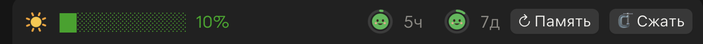
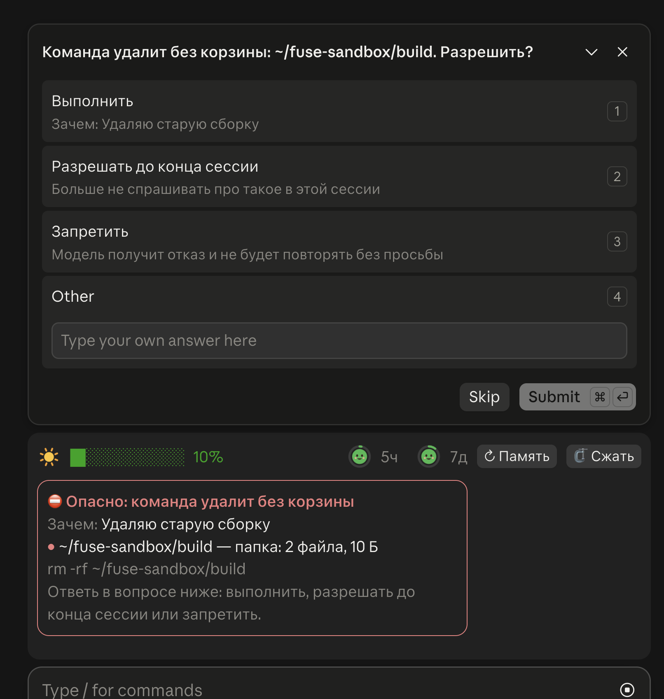

# cockpit

Плагин Claude Code: всё, что нужно видеть над строкой ввода, и предохранитель от опасных команд. Работает в десктопе (вкладка Code) и в терминале.

## Что внутри



**Полоса над вводом:**
- погода контекстного окна: от ясного неба до урагана по мере заполнения, прогресс-бар и процент;
- лимиты на 5 часов и неделю: два маленьких Claude в кольцах, которые желтеют, краснеют и грустнеют вместе с лимитом; в подсказке процент и время до сброса;
- кнопка «🗜 Сжать»: обычный `/compact`; если сейчас идёт ответ, сжатие встанет в очередь и выполнится, когда сессия освободится.

**Предохранитель.** Перед опасным вызовом останавливает его, играет короткую сирену и спрашивает: выполнить, разрешать такое до конца сессии или запретить. Над вводом висит красная карточка: что произойдёт, зачем модель это делает и что затронет — для рекурсивного удаления каждый путь с числом файлов и размером. Ловит:
- `rm -rf`, `git push --force`, `reset --hard`, `clean -f`, откат правок, `branch -D`, `curl … | bash`, `sudo`, удаление в kubectl и yc, `DROP`, `TRUNCATE`, `DELETE` без `WHERE`;
- в MCP — удаление, массовые правки, разрушительный SQL, посты в Mattermost, письма, открытие доступа на Drive; удаление артефакта.



В автозадачах отвечать некому: разрушительное запрещается сразу, посты и письма проходят.

## Установка

```bash
claude plugin marketplace add tsergeytovarov/ai-settings
claude plugin install cockpit@popovs
```

Заработает в новой сессии.

## Разработка

Код полосы и предохранителя живёт в соседних плагинах `context-weather` и `airbag`; здесь их копии. Руками копии не правь: правь исходник и синхронизируй.

```bash
cd plugins
python3 cockpit/scripts/sync.py          # обновить копии
python3 cockpit/scripts/sync.py --check  # проверить, что копии свежие
```

Скрипт переименовывает ключи состояния в `cockpit` и переносит сирену `sounds/alarm.wav`. Своё у плагина — только кнопка «Сжать» (`hooks/compact.tsx`) и `hooks/register.tsx`, который собирает три части в один модуль: движок разрешает плагину один модуль хуков и одну подписку на событие без фильтра.

Проверка: `claude plugin validate .` и `claude plugin test .`
